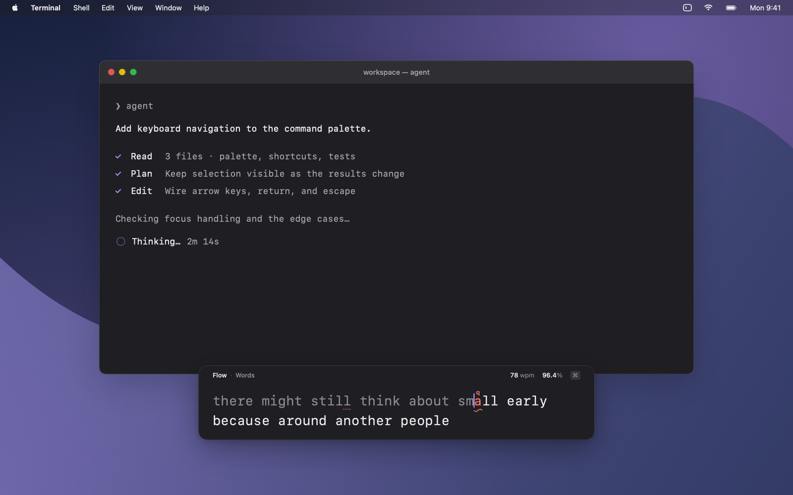
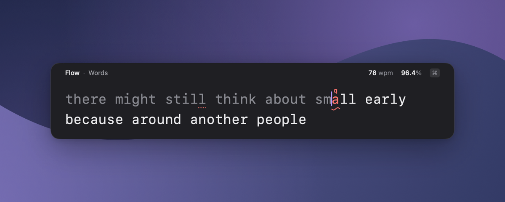
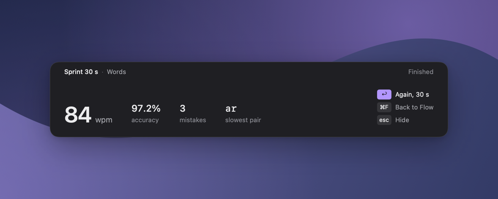
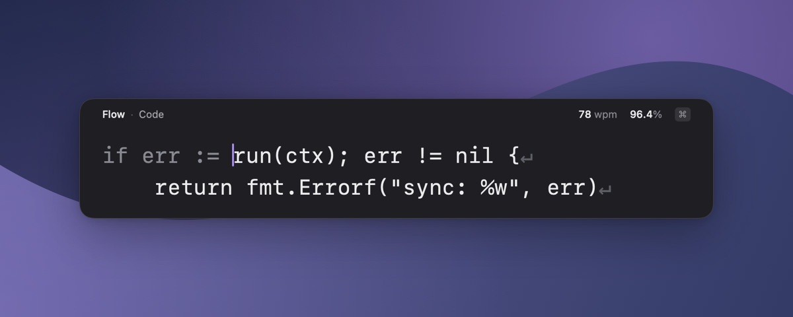
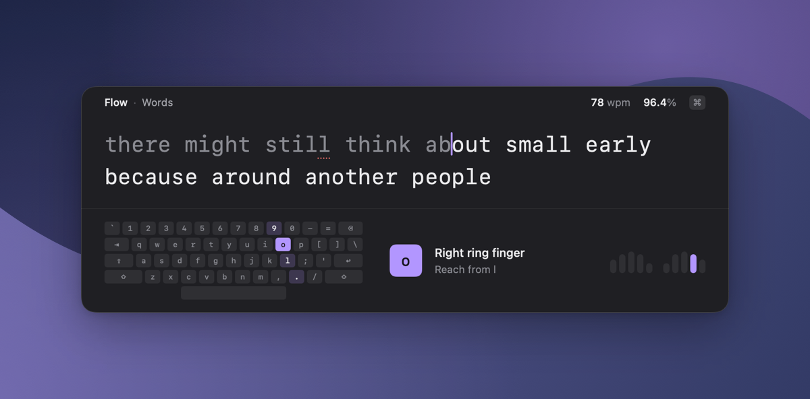
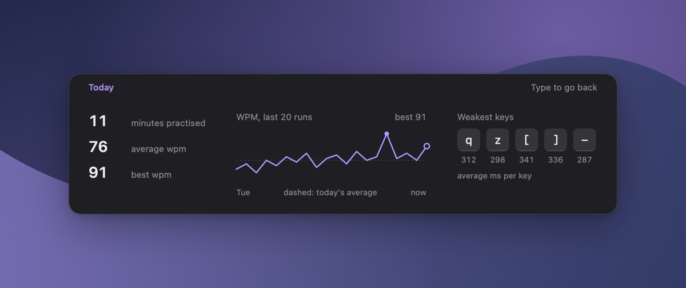
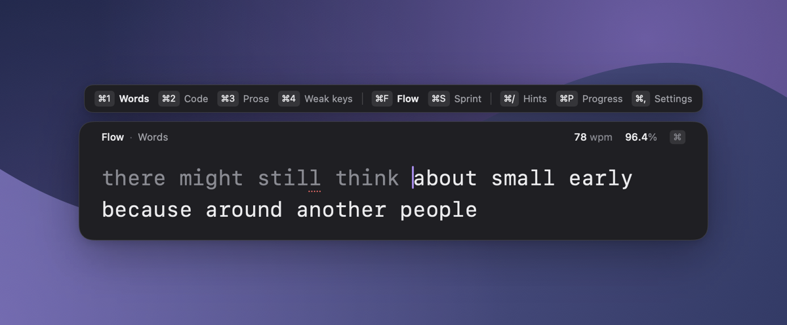

<div align="center">

# Twiddle

### You were going to twiddle your thumbs anyway.

**Your agent is thinking. Your build is running. Slack is typing…**<br>
Press a hotkey, get faster at typing right where you are, and vanish.

<picture>
  <source media="(prefers-color-scheme: light)" srcset="docs/screenshots/hero-light.png">
  
</picture>

`macOS 26` · `Apple silicon` · `no account` · `no permissions` · `nothing uploaded` · `MIT`

</div>

## The thirty-second gym

Typing apps ask you to leave what you're doing. Twiddle doesn't. `⌃⌥Space` drops a small panel on your current Space, even over a full-screen app. The app you were in stays frontmost, and whatever you're waiting on stays in view.

Start typing. Press `Esc` when the wait is over. Next time, Flow picks up at the start of your unfinished word.

No session to start. No score to protect. No timer unless you ask for one.

## What's inside

<table>
<tr>
<td width="50%"><br><b>Flow</b><br>Endless text, no timer. Idle time doesn't count against your speed.</td>
<td width="50%"><br><b>Sprint</b><br>15, 30 or 60 seconds, then a result card. <code>⌘S</code> and go.</td>
</tr>
<tr>
<td><br><b>Practice what you actually type</b><br>Common words, code and terminal commands, classic prose, or drills built from your weakest keys.</td>
<td><br><b>Finger hints</b><br>An optional keyboard map shows which finger should take the next key. It guides, and never grades.</td>
</tr>
<tr>
<td><br><b>Progress</b><br>Today's numbers, your recent trend and your slowest keys. A glance, not a dashboard.</td>
<td><br><b>All keyboard</b><br>Hold <code>⌘</code> to see every command. The mouse can stay where it is.</td>
</tr>
</table>

## Keys

| Key | Does |
|---|---|
| `⌃⌥Space` | Summon or dismiss |
| `Esc` | Dismiss |
| `⌘F` | Flow |
| `⌘S` | Sprint. Press again to cycle 15, 30 and 60 seconds before you start, or to restart a running sprint |
| `⌘1` `⌘2` `⌘3` `⌘4` | Words, Code, Prose, Weak keys |
| `⌘/` | Finger hints |
| `⌘P` | Progress |
| `⌘,` | Settings |

Clicking another window dismisses the panel too. The menu-bar icon opens Practise, Progress and Settings.

## Install

There's no download yet, so you build it yourself. You need an Apple silicon Mac with macOS 26 and Xcode 26, with its command-line tools selected.

```sh
git clone https://github.com/kartiksayani/twiddle.git
cd twiddle
make install
open /Applications/Twiddle.app
```

Then press `⌃⌥Space`. `make install` replaces any existing copy. The app is ad hoc signed, so build it on the Mac you'll use it on.

To change the hotkey, open Settings and click Summon hotkey. Type a shortcut containing Command, Control or Option. Escape cancels and Backspace clears it. If a shortcut is already taken, pick another; Practise in the menu bar still works.

## Your data stays yours

Twiddle only reads keys while its panel is open, and asks for no Accessibility or Input Monitoring access. Practice data lives in `~/Library/Application Support/Twiddle/state.json`, and preferences use macOS UserDefaults. Nothing is uploaded. macOS manages Launch at login.

## Credits

Prose comes from *Alice's Adventures in Wonderland* by Lewis Carroll (1865) and *The Time Machine* by H. G. Wells (1895), both public domain and checked against [Project Gutenberg](https://www.gutenberg.org). Words, code and drills were written for the project.

Images are composed from the app's real views by `make screenshots`. The desktop behind the panel is drawn, and the live app adds macOS's blur.

Built by [Codex](https://openai.com/codex/) and [Claude Code](https://claude.com/claude-code), with the process in [`ORCHESTRATOR.md`](ORCHESTRATOR.md). Released under the [MIT License](LICENSE).
